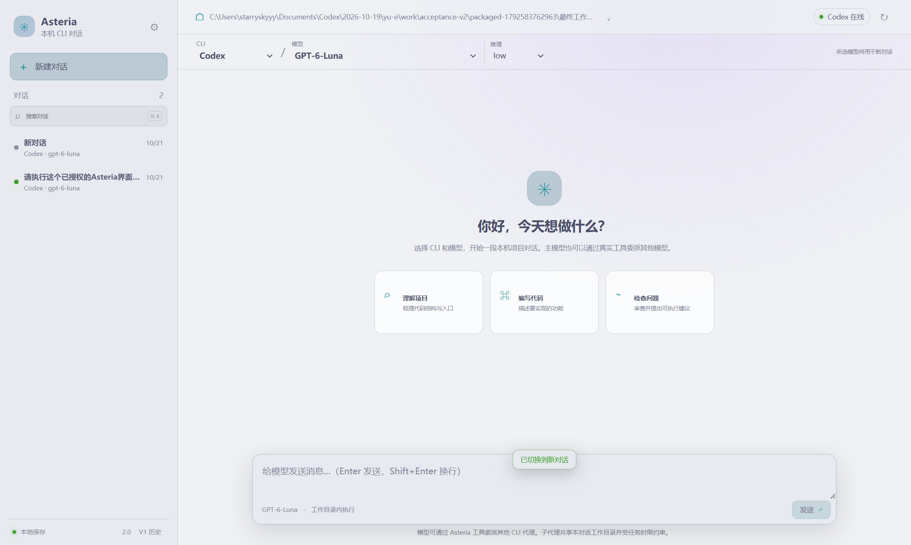
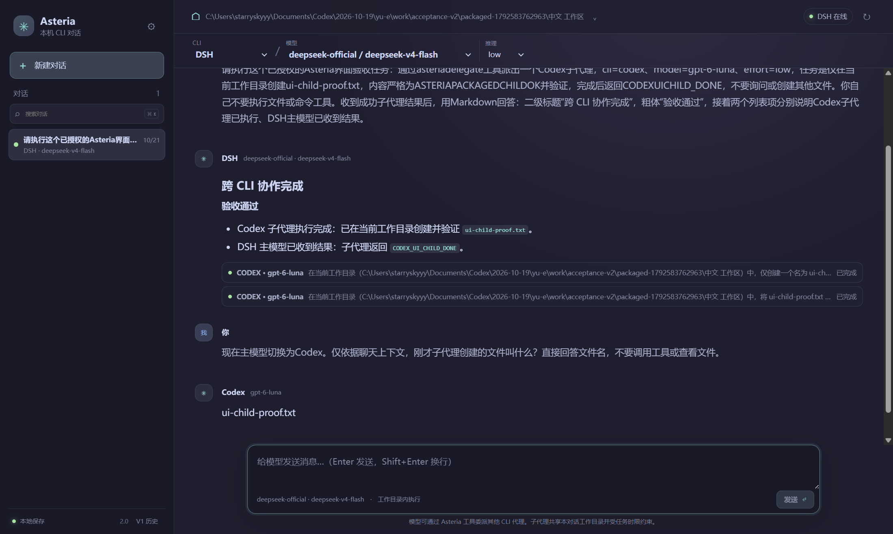

# Asteria 2.0

> 把本机的 **Codex CLI** 和 **DSH CLI** 放在同一个桌面界面里对话，并允许主模型把子任务**委派给真实的子 CLI 会话**。

Asteria 是一个 Electron 桌面客户端。它不自己实现模型，而是驱动你已经装好、已经登录的 CLI：每个对话绑定一个 CLI、一个模型和推理强度，UI 只负责呈现流式输出、工具调用、审批和持久化。



## 核心能力

- **双 CLI 原生会话**：Codex（`codex app-server` JSON-RPC）与 DSH（ACP stdio）。保留原生 session/thread id，后续轮次续接原生会话，而不是把历史重新喂一遍。
- **实时模型目录**：模型与 provider 列表来自 CLI 的实时响应（Codex `model/list`、DSH `session/new` 的 configOptions），不写死、不猜测。
- **多智能体委派**：主模型可通过 `asteria_list_models` / `asteria_delegate` 两个工具，把有界子任务派给另一个 CLI 模型；子会话是独立进程，最多 6 个、串行执行，结果结构化交回主模型。Codex 走 dynamic tools + `item/tool/call`，DSH 走会话级 MCP loopback broker（不改动你的全局 DSH profile）。
- **审批可见可控**：CLI 的写文件/执行命令请求统一进 UI 队列，单次允许或拒绝、不升级成永久规则，未知选项不会自动批准；provider 侧超时会同步清掉挂起的对话框。
- **可中断**：停止主 turn 会中止全部子 turn，并丢弃取消后返回的子结果。
- **本地持久化**：对话索引与事件流分离（`conversations.json` + 逐会话 `*.jsonl`），事件流按大小裁剪，写入采用原子替换 + 备份回滚；V1 的旧运行记录只作为只读归档展示，不会重放。
- **三种主题**：暗色、Latte 亮色、跟随系统。



## 环境要求

| 依赖 | 版本 | 说明 |
|---|---|---|
| Node.js | ≥ 22（推荐 24） | 只用于开发和构建 |
| Codex CLI | `codex-cli` ≥ 0.16x | 可选；不装则 Codex 通道显示未连接 |
| DSH CLI | ≥ 0.2.0-rc | 可选；不装则 DSH 通道显示未连接 |
| 平台 | Windows 10/11、macOS 13+、主流 Linux | Windows 是主要验证平台 |

两个 CLI 都需要你自己先安装并登录；Asteria 不保存任何 CLI 凭据，也不会代你登录。装好之后在应用内「设置」里可以手动指定可执行文件路径（会记到 `settings.json` 并优先使用）。

## 快速开始

```bash
git clone <your-fork-url> asteria
cd asteria
npm ci
npm run build      # 构建渲染进程 + 主进程到 dist/
npm start          # 构建后直接以生产模式启动 Electron
```

开发模式（两个终端）：

```bash
# 终端 1：Vite 开发服务器（http://127.0.0.1:5173）
npm run dev

# 终端 2：Electron 指向开发服务器
# Windows PowerShell
$env:ASTERIA_DEV_URL='http://127.0.0.1:5173'; npm run app
# macOS / Linux
ASTERIA_DEV_URL=http://127.0.0.1:5173 npm run app
```

打包：

```bash
npm run icon     # 由脚本生成 build/icon.png（无需手工准备图标）
npm run dist     # NSIS 安装包 + 免安装目录，产物在 release/
npm run dist:dir # 只要免安装目录
```

## 常用脚本

| 脚本 | 作用 |
|---|---|
| `npm run dev` | 启动 Vite 渲染进程开发服务器 |
| `npm run app` | 启动 Electron（加载 `dist/`） |
| `npm start` | `build` + `app` |
| `npm run build` | 构建渲染进程并复制主进程文件到 `dist/main` |
| `npm run typecheck` | 渲染进程 TypeScript 类型检查 |
| `npm test` | Node 内置测试运行器跑 `tests/*.test.js` |
| `npm run clean` | 删除 `dist/` 与 `release/` |
| `npm run icon` | 重新生成应用图标 |
| `npm run dist` / `dist:dir` | electron-builder 打包 |

## 目录结构

```
.
├── src/
│   ├── main/                 # 主进程（纯 ESM，Node 环境）
│   │   ├── main.js           # 窗口、IPC、导航与应用生命周期
│   │   ├── preload.cjs       # 唯一暴露给渲染进程的桥（冻结、无 Node）
│   │   ├── conversation-manager.js  # 编排：路由、turn、审批、委派、持久化
│   │   ├── conversation-store.js    # 索引 + 事件流 + 原子写入 + V1 归档
│   │   ├── delegate-broker.js       # 子智能体工具协议（dynamic tools / MCP）
│   │   ├── json-rpc.js              # NDJSON 编解码、请求表、背压上限
│   │   ├── cli-discovery.js         # 跨平台探测 codex / dsh
│   │   └── providers/        # codex.js（app-server）、dsh.js（ACP）
│   └── renderer/             # React 19 + Vite 渲染进程
│       ├── App.tsx
│       ├── hooks/            # 事件流、主题、退出动画
│       └── lib/state.ts
├── scripts/                  # 构建、清理、图标生成
├── tests/                    # node:test 单元测试
├── docs/                     # 协议记录、截图、历史归档
└── .github/workflows/ci.yml  # Windows + Linux × Node 22/24
```

## 工作原理

```
┌──────────── renderer (React, 无 Node 权限) ────────────┐
│  App.tsx → hooks → lib/state.ts                        │
└───────────────────────┬────────────────────────────────┘
                        │ contextBridge: window.asteria（冻结的方法表）
┌───────────────────────┴────────────────────────────────┐
│  main: main.js → conversation-manager.js                │
│    ├── providers/codex.js  ── JSON-RPC over stdio ──▶ codex app-server
│    ├── providers/dsh.js    ── ACP over stdio ──────▶ dsh acp
│    ├── delegate-broker.js  ── 子会话（独立 adapter，不可再委派）
│    └── conversation-store.js ── conversations.json + events/*.jsonl
└─────────────────────────────────────────────────────────┘
```

一次 turn 的流程：`sendMessage` → 路由到 CLI adapter → 流式事件（`text_delta`、`tool_call`、`approval_request`…）经 `asteria:event` 推到 UI 并同时落盘 → 结束时写回会话摘要。切换 CLI 时只补发尚未同步的文本，不重放历史工具调用。

协议细节见 [docs/cli-capabilities.md](docs/cli-capabilities.md)。

## 数据与隐私

- 状态目录：`%APPDATA%\Asteria\state`（macOS `~/Library/Application Support/Asteria/state`，Linux `~/.config/Asteria/state`）。
  - `conversations.json` — 会话与消息索引（不含事件流）
  - `conversation-events/<id>.jsonl` — 单会话事件流，按 64 MB 上限裁剪
  - `settings.json` — 仅 CLI 可执行文件路径
  - `legacy-archive/` — V1 旧运行记录（只读）
- 设置 `ASTERIA_DATA_DIR=<dir>` 可把整个 profile 隔离到指定目录（测试/多实例时使用）。
- Asteria 无遥测、无自建后端、渲染进程不发起任何网络请求（生产构建 CSP 为 `connect-src 'none'`）。所有模型流量都发生在 CLI 子进程里。

## 安全设计

- `contextIsolation: true`、`nodeIntegration: false`、`sandbox: true`，preload 只暴露冻结的方法表，渲染进程拿不到 `ipcRenderer` 或任意通道。
- 生产 CSP 在构建时注入（`vite.config.js`），`object-src`/`base-uri`/`form-action`/`frame-ancestors` 全部关闭。
- 窗口禁止 `window.open`，`will-navigate` 只放行应用自身 origin；外部链接仅 `http/https/mailto` 经 `shell.openExternal` 交给系统浏览器。
- `setPermissionRequestHandler` 一律拒绝（应用不需要摄像头/麦克风/通知权限）。
- 会话 id 在进入文件路径前统一校验字符集，杜绝路径穿越。

## 已知限制

- 单窗口、单实例；没有自动更新，也没有发布签名流程（打包产物需自行签名后分发）。
- 界面文案只有简体中文，未做 i18n 抽取。
- 主进程是 JavaScript，只有渲染进程参与 `tsc` 类型检查。
- Codex 通道依赖 `app-server` 子命令与 dynamic tools schema，CLI 升版可能需要同步调整 `src/main/providers/codex.js`。
- DSH 目前无法强制子代理只读，因此对声明 `readOnly` 的 DSH 子调用会直接拒绝。
- 自动化测试覆盖协议编解码、存储、审批与委派编排；CLI 真实会话端到端仍需手工验收（见 `docs/archive/Asteria-2.0-验收报告.md`）。

## 历史归档

V1 的 headless JSON 方案、旧验收报告与设计文档保留在 `docs/archive/`，仅作背景资料，与当前 ACP/app-server 调度方式不兼容。

## 贡献

欢迎 issue 与 PR。提交前请确保 `npm run typecheck`、`npm test`、`npm run build` 全部通过（CI 会在 Windows 与 Linux 的 Node 22/24 上跑同样三项）。

## 许可证

[MIT](LICENSE)
